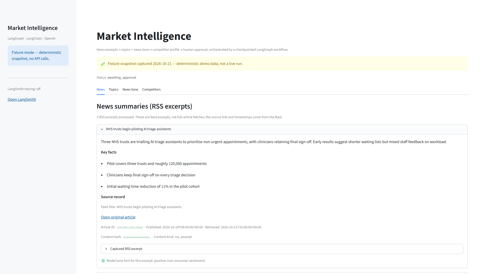
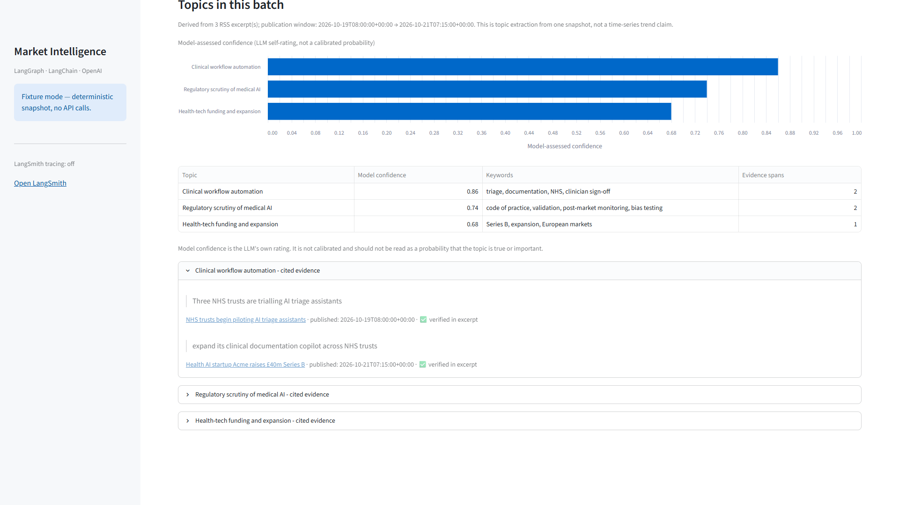
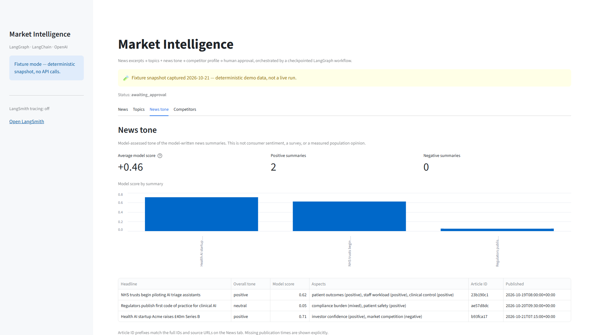
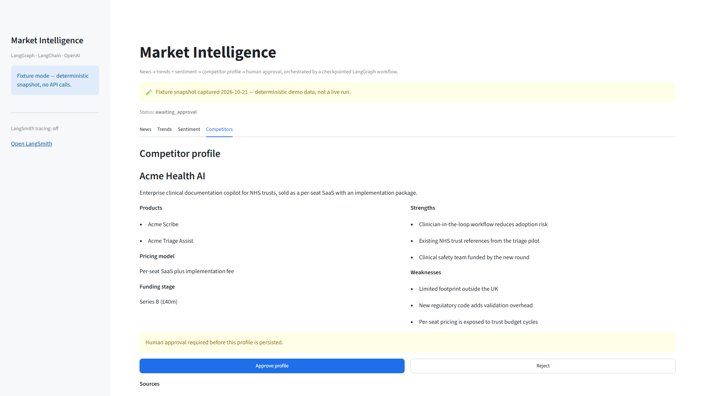
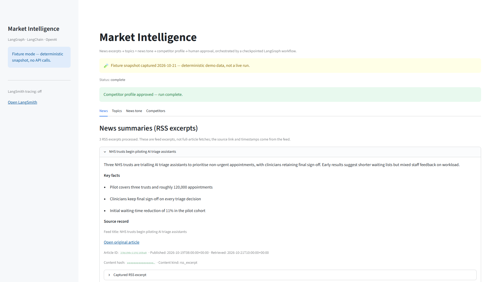

# Multi-Agent AI Ecosystem for Market Intelligence

[](./LICENSE)

A comprehensive multi-agent system designed to automate market intelligence gathering, processing, and analysis. This project implements specialized AI agents that work together to provide insights from RSS news excerpts, competitor pages, extracted topics, and model-assessed news tone.

> 📄 **Production roadmap:** see [`PRODUCTION_PLAN.md`](./PRODUCTION_PLAN.md) for the full migration plan (LangGraph · LangChain · Oracle 23ai · LangSmith · Grafana · RAGAS).

## 🚀 Features

### Core Agents
- **News Summarization Agent**: Monitors RSS feeds and creates summaries with source provenance
- **Competitor Analysis Agent**: Fetches a competitor page and records the retrieved source
- **Topic Extraction Agent**: Extracts topics from one RSS snapshot with cited evidence spans
- **News Tone Agent**: Model-assesses the tone of the news summaries (not consumer sentiment)

### Orchestration
- **LangGraph workflow**: typed state, checkpointing, retries, and a human-in-the-loop approval gate
- **Legacy orchestrator**: the original sequential MVP pipeline, kept as a runnable baseline

## 📁 Project Structure

```
├── agents/
│   ├── news_summarization_agent/
│   │   └── news_agent_mvp.py          # News monitoring and summarization
│   ├── competitor_analysis_agent/
│   │   └── competitor_agent_mvp.py    # Competitor tracking and analysis
│   ├── trend_identification_agent/
│   │   └── trend_agent_mvp.py         # Trend detection and analysis
│   └── consumer_sentiment_analysis_agent/
│       └── sentiment_agent_mvp.py     # Sentiment analysis engine
├── orchestration/
│   └── main_orchestrator_mvp.py       # Main coordination system
├── src/market_intelligence/           # LLM agents + LangGraph workflow
│   ├── agents/                        # news, topics, tone, competitor
│   └── graph/                         # state, nodes, supervisor, serde
├── data/                              # Runtime output / cache
├── PRODUCTION_PLAN.md                 # Production-grade migration roadmap
├── page.tsx                           # Web UI component
├── documentation/
│   ├── AI Agent Ecosystem Architecture for Market Intelligence.md
│   ├── AI Agent Ecosystem_ Components and Roles.md
│   └── Critical Analysis of the AI Agent Ecosystem for Market Intelligence.md
├── assets/
│   ├── hero_image_symbiotic_intelligence.png
│   └── icon_*.png                     # Agent icons
└── README.md
```

> **Legacy vs. LLM:** the `agents/` and `orchestration/` directories at the repo root are the
> **legacy deterministic MVP** (runnable baseline). The **LLM-backed agents** live in
> `src/market_intelligence/agents/` (imported as `market_intelligence.agents.*`). The legacy
> tree will be removed in a later phase of `PRODUCTION_PLAN.md`.

## 🛠️ Current Implementation Status

### MVP Features (✅ Implemented)
- Basic RSS feed processing
- Simple web scraping capabilities
- Keyword-based trend analysis
- Rule-based sentiment classification
- Sequential agent orchestration

### Production Features (🚧 In progress — see `PRODUCTION_PLAN.md`)
- ✅ **LLM agents** via LangChain (`init_chat_model` → OpenAI) with typed Pydantic structured output
- ✅ **LangGraph** orchestration with checkpointing, retries, and human-in-the-loop
- 🚧 **Oracle Autonomous Database 23ai** persistence + AI Vector Search (RAG) — the `persist`
  node is currently an injected placeholder, so an approved run is not stored yet
- 🚧 **Observability** via LangSmith + OpenTelemetry → Grafana Cloud
- 🚧 **Evaluation** via RAGAS + LangSmith datasets (offline + online)
- ✅ **Streamlit demo UI** with live agent streaming

## 🚀 Quick Start

### Prerequisites
Python 3.11+ (Streamlit 1.66, used by the demo, requires 3.11 or newer) and the pinned
dependencies in `pyproject.toml`.

```bash
python -m venv .venv
# Windows:
.venv\Scripts\activate
# macOS/Linux:
source .venv/bin/activate

# Canonical install (package + runtime dependencies):
pip install -e .
# Development install (adds test tooling):
pip install -e ".[dev]"
```

> `requirements.txt` mirrors the runtime pins from `pyproject.toml` for environments that
> only need the dependencies, not the package itself (`pip install -r requirements.txt`).

### Running the System
Run from the repository root so the `agents` package is importable.

```bash
# Run individual agents
python agents/news_summarization_agent/news_agent_mvp.py
python agents/competitor_analysis_agent/competitor_agent_mvp.py
python agents/trend_identification_agent/trend_agent_mvp.py
python agents/consumer_sentiment_analysis_agent/sentiment_agent_mvp.py

# Run complete orchestrated system (from the repo root)
python -m orchestration.main_orchestrator_mvp
```

### LangGraph workflow (Phase 2)

```python
from langgraph.checkpoint.memory import InMemorySaver
from langgraph.types import Command
from market_intelligence.graph import build_graph

graph = build_graph(checkpointer=InMemorySaver())
config = {"configurable": {"thread_id": "demo-1"}}

graph.invoke(
    {
        "rss_url": "https://feeds.bbci.co.uk/news/business/rss.xml",
        "competitor_url": "https://www.google.com/about/",
        "num_articles": 2,
    },
    config,
)  # pauses at review_profile

graph.invoke(Command(resume={"approved": True}), config)
```

The run pauses at `review_profile` before the approved profile would be persisted. Resume
with an explicit boolean decision (`{"approved": True}` or `{"approved": False}`); rejection
ends the run without calling the writer. Invalid payloads are rejected and re-prompt instead
of being coerced. `SqliteSaver` (from `langgraph.checkpoint.sqlite`) keeps checkpoints across
processes.

> Approval gates **business persistence/export**, not checkpoint storage: the checkpoint
> already holds the pending profile. The Node local demo injects `NullProfileWriter`; the
> durable SQLite store replaces it in the data-layer phase.

### Example Output
The orchestrator will:
1. Fetch and summarize recent RSS excerpts
2. Extract topics from the captured excerpts, with source IDs and evidence quotes
3. Model-assess the tone of the news summaries
4. Scrape competitor information from a predefined URL and record the retrieved source
5. Display coordinated results from all agents

### 🔎 Provenance and limits

Every displayed item is tied to a captured source record:

- **News** cards show the article ID, source URL when the feed supplies one, publication
  and retrieval timestamps, content hash, and the exact RSS excerpt. The UI labels these as
  excerpts, not full-article fetches. Missing URLs or publication times are shown explicitly.
- **Topics** are extracted from one RSS snapshot. The UI calls them topics, shows the
  publication window and source count, and does not claim a time-series trend. Each cited
  quote is resolved against the captured excerpt: verified quotes are marked, and unknown
  article IDs or non-verbatim quotes are marked unverified and surfaced as warnings.
- **Model confidence** is the LLM's own 0–1 self-rating. It is not a calibrated probability.
- **News tone** is a model assessment of the model-written summary. It is not consumer
  sentiment, a survey, or a measured population opinion.
- **Competitor sources** are built from the page actually retrieved (final URL, retrieval
  time, content hash), not from links the model invents.

> Schema note: this version stores `topics` and `tones` instead of the earlier `trends`
> and `sentiments` fields. Reset old local checkpoint threads before using them with this
> build.


## ⚙️ Configuration

The LLM agents (`src/market_intelligence/`) read settings from environment variables or a
`.env` file (copy `.env.example` to `.env`). Model, network limits and run ceilings are
configurable:

| Variable | Default | Purpose |
|---|---|---|
| `OPENAI_API_KEY` | _(empty)_ | OpenAI API key (required for live LLM runs) |
| `OPENAI_MODEL` | `gpt-4o-mini` | Model used by all agents |
| `NEWS_REQUEST_TIMEOUT` | `15.0` | RSS request timeout (seconds, connect + read) |
| `COMPETITOR_REQUEST_TIMEOUT` | `15.0` | Competitor page request timeout (seconds) |
| `MAX_REDIRECTS` | `3` | Redirects followed, each target revalidated |
| `NUM_ARTICLES` | `2` | Articles processed per run (1–10) |
| `MAX_ARTICLES` | `10` | Hard upper bound for `NUM_ARTICLES` |
| `MIN_ARTICLE_CHARS` | `40` | Minimum RSS excerpt length before an article is skipped |
| `MAX_FEED_BYTES` | `2000000` | Maximum RSS body size |
| `MAX_PAGE_BYTES` | `1000000` | Maximum competitor page size |
| `MAX_COMPETITOR_CHARS` | `8000` | Page text sent to the model |
| `LLM_REQUEST_TIMEOUT` | `30.0` | Per-request LLM timeout (seconds) |
| `LLM_MAX_OUTPUT_TOKENS` | `512` | Output-token cap per LLM call |
| `MAX_RUN_TOKENS` | `20000` | Per-run token ceiling (fails closed when usage is reported) |
| `MAX_RUN_LLM_CALLS` | `24` | Per-run LLM call ceiling |

### 🛡️ Ingestion safety

All RSS and competitor fetches go through one bounded client (`src/market_intelligence/net.py`):

- Only `http`/`https` URLs on ports 80/443 are allowed; embedded credentials are rejected.
- The host is resolved and every address must be globally routable. Redirect targets are
  revalidated, so a public URL cannot redirect the app to `localhost`, a private network, or
  a cloud metadata endpoint.
- Status, content type, redirect count and body size are checked before parsing.
- Feeds are parsed from bounded bytes. Malformed or empty feeds fail with a clear error;
  short/unusable excerpts are skipped with a visible warning instead of being sent to the
  model.
- LangGraph retries only transient failures (timeouts, connection errors, 429 and 5xx). A
  malformed feed, SSRF rejection or 4xx response is permanent and is not retried.
- Each run has a call ceiling and, when the provider reports usage, a token ceiling. Exceeding
  either fails the run instead of continuing to spend.

> SSRF note: validation resolves DNS and the HTTP client resolves again. A determined
> DNS-rebinding attack could still swap the address between lookups. Pin the connection to the
> validated IP, or use an egress proxy, before exposing this app to untrusted users.

### 🔐 Secrets

- **Never commit `.env`.** It is ignored via `.env*` (with a `!.env.example` exception);
  the repository tracks placeholders only.
- **Local development:** `cp .env.example .env`, then add the key. `.env` never leaves your
  machine.
- **Rotate immediately** if a key is ever pasted into chat, a log, or a ticket. Revoke it in
  the provider console and issue a new one — deleting the file does not undo the exposure.
- **Pre-commit guard:** after `pip install -e ".[dev]"`, run `pre-commit install` once.
  `detect-secrets` (against `.secrets.baseline`) and `detect-private-key` then block staged
  credentials. Run manually with `pre-commit run --all-files`.
- **CI and deployed environments:** inject secrets from GitHub Actions secrets or a managed
  store (e.g. OCI Vault). Do not ship `.env` files to servers.

### 💰 Cost per run

**Measured** on 2026-10-21 with `gpt-4o-mini`, 2 BBC Business RSS articles, and
`https://www.google.com/about/` as the competitor page:

| Metric | Value |
|---|---|
| LLM calls | 6 |
| Prompt tokens | 1,622 |
| Completion tokens | 767 |
| **Total tokens** | **2,389** |
| **Estimated cost** | **~$0.0007 per run** |

Rates used: $0.15 per 1M input tokens and $0.60 per 1M output tokens (`gpt-4o-mini`
list prices at measurement time). Output was capped at 512 tokens per call; wall clock
was 16.6s.

## 🖥️ Streamlit Demo

The demo drives the same `build_graph()` workflow, streams each node's completion into the
status panel, and renders results into four tabs. When the graph hits the HITL interrupt, the
Competitors tab shows the pending profile with **Approve** / **Reject** buttons.

### Run it

```bash
pip install -e ".[demo]"
cp .env.example .env          # add OPENAI_API_KEY
streamlit run app.py
```

### Fixture mode (no API key)

Screenshots and reviews use a committed snapshot so captures are deterministic and offline:

```powershell
$env:DEMO_MODE=1; streamlit run app.py
```

The app labels it as **fixture data captured 2026-10-21 — not a live run**.

### Screenshots (1920×1080)

| News | Topics |
|---|---|
|  |  |

| News tone | Competitor approval (HITL) |
|---|---|
|  |  |



## 📊 Architecture Overview

```
┌─────────────────┐    ┌──────────────────┐    ┌─────────────────┐
│  News Agent     │    │ Competitor Agent │    │  Topic Agent    │
│                 │    │                  │    │                 │
│ • RSS Parsing   │    │ • Web Scraping   │    │ • Source IDs    │
│ • Summarization │    │ • Retrieved Src  │    │ • Evidence Check│
└─────────┬───────┘    └────────┬─────────┘    └─────────┬───────┘
          │                     │                        │
          │              ┌──────▼──────┐                 │
          └──────────────►│ Orchestrator├─────────────────┘
                         │             │
          ┌──────────────►│ Coordinates ├─────────────────┐
          │              │  All Agents │                 │
          │              └─────────────┘                 │
          │                                              │
┌─────────▼───────┐                              ┌───────▼─────────┐
│ News Tone Agent │                              │   Data Storage  │
│                 │                              │                 │
│ • Summary Tone  │                              │ • Results       │
│ • Aspect Tone   │                              │ • Insights      │
└─────────────────┘                              └─────────────────┘
```

## 🔧 Technology Stack

**Current MVP Stack:**
- Python 3.x
- feedparser (RSS processing)
- requests + BeautifulSoup (web scraping)
- collections.Counter (basic analytics)

**Planned Production Stack:**
- LangGraph (stateful orchestration) + LangChain (typed agents & tools)
- OpenAI models (`init_chat_model` provider-agnostic)
- Oracle Autonomous Database 23ai — AI Vector Search (HNSW/IVF) via `langchain-oracledb`
- LangSmith (tracing, evals, prompts) + OpenTelemetry → Grafana Cloud (Tempo/Loki/Prometheus)
- RAGAS (faithfulness, answer relevancy, context precision/recall)
- FastAPI (serving) + Streamlit (demo UI)

## 📈 Roadmap

| Phase | Scope |
|---|---|
| 0 — Foundation | Packaging (`pyproject.toml` + `uv`), config, `structlog`, CI, tests |
| 1 — LLM-ify agents | Typed OpenAI agents + tools (`with_structured_output`) |
| 2 — Orchestration | LangGraph supervisor graph + checkpointing + HITL |
| 2.5 — Streamlit demo | Vertical slice: stream all agents into tabs + approve button |
| 3 — Data | Oracle 23ai schema, embeddings, vector search/RAG |
| 4 — Observability | LangSmith + OTel → Grafana Cloud |
| 5 — Evals | RAGAS + LangSmith datasets, CI gating |
| 6 — Serving & hardening | FastAPI, background jobs, Docker/K8s/OCI, security |

See `PRODUCTION_PLAN.md` for full detail and exit criteria.

## 🤝 Contributing

This project is designed as a comprehensive market intelligence solution. Future contributions could focus on:

- Enhanced agent capabilities
- Integration with additional data sources
- Advanced AI/ML model integration
- UI/UX improvements
- Performance optimization

## 📄 Documentation

- **Production roadmap:** [`PRODUCTION_PLAN.md`](./PRODUCTION_PLAN.md)
- **Architecture Overview**: System design and component relationships
- **Component Specifications**: Detailed role definitions for each agent
- **Critical Analysis**: SWOT analysis and relevance assessment

## 🔐 Security & Privacy

- API keys live in `.env` locally and in a managed secret store when deployed — see
  [Secrets](#-secrets).
- Pre-commit hooks (`detect-secrets`, `detect-private-key`) block accidental commits.
- Follow data privacy regulations (GDPR, CCPA)
- Secure web scraping practices
- Ethical AI model deployment

## 📞 Support

For questions about implementation or extending this system, refer to the comprehensive documentation provided in the project.

## License

Released under the [MIT License](./LICENSE). Copyright (c) 2026 arvindram27.

---

**Status**: MVP Implementation Complete | **Next Phase**: LLM Integration & Production Readiness (see `PRODUCTION_PLAN.md`)
