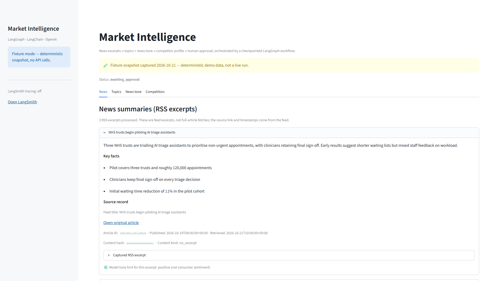
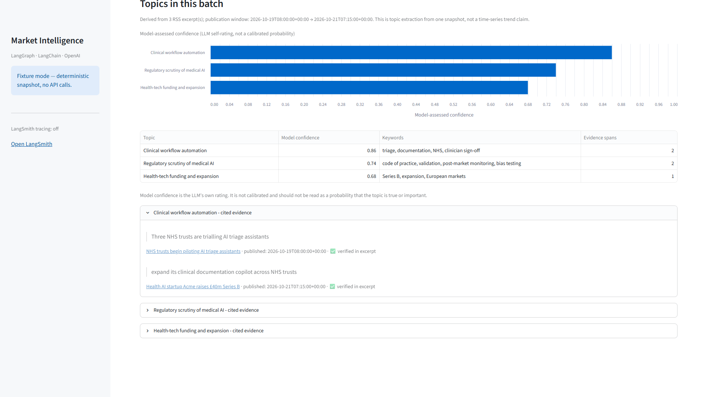
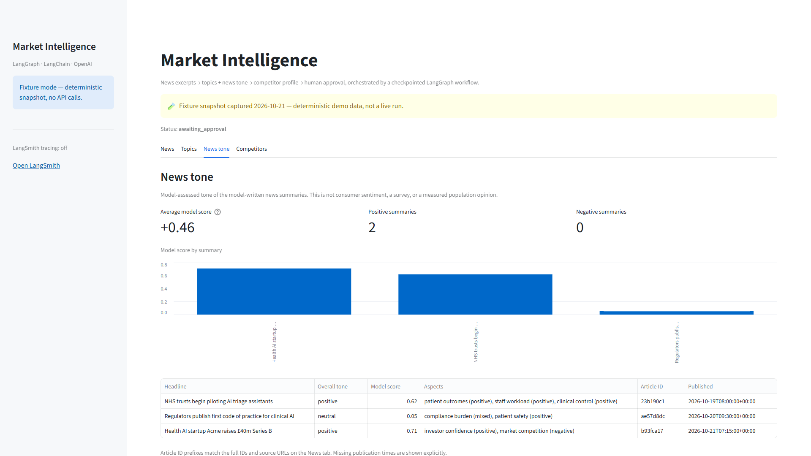
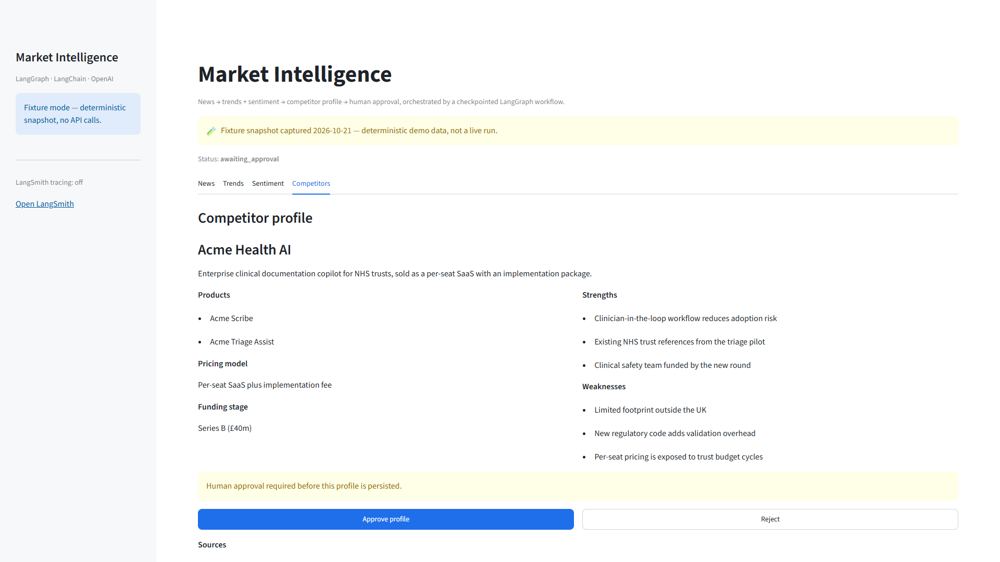
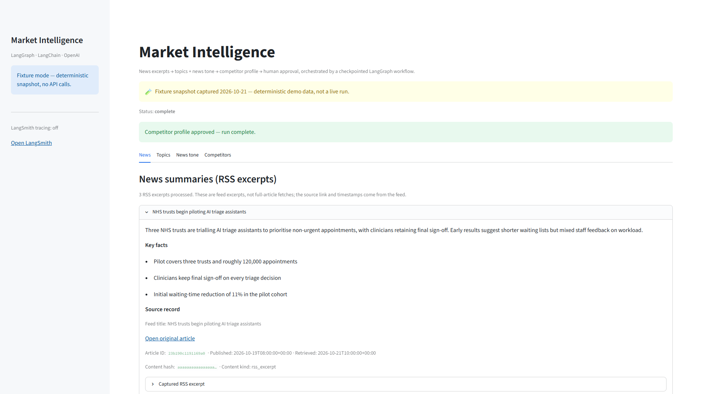

<p align="center">
  
</p>

<h1 align="center">Multi-Agent AI Ecosystem for Market Intelligence</h1>

<p align="center">
  <strong>RSS news excerpts in, structured summaries and analysis out: typed LLM agents on a checkpointed LangGraph workflow, with Postgres persistence and a human approval gate.</strong>
</p>

<p align="center">
  <a href="https://github.com/arvindram27/multi-agent-market-intelligence/actions/workflows/ci.yml"></a>
  <a href="./LICENSE"></a>
  
</p>

<p align="center">
  <a href="#-streamlit-demo">Demo</a> ·
  <a href="#-quick-start">Quick start</a> ·
  <a href="#-architecture-overview">Architecture</a> ·
  <a href="./PRODUCTION_PLAN.md">Production plan</a>
</p>

<p align="center">
  <br/>
  <em>Fixture-mode demo snapshot - not a live run.</em>
</p>

A comprehensive multi-agent system designed to automate market intelligence gathering, processing, and analysis. This project implements specialized AI agents that work together to provide insights from RSS news excerpts, competitor pages, extracted topics, and model-assessed news tone.

> 📄 **Production roadmap:** see [`PRODUCTION_PLAN.md`](./PRODUCTION_PLAN.md) for the target architecture, and the deferred directions under evaluation (Oracle 23ai, LangSmith, Grafana Cloud, RAGAS - not built features).

## 🚀 Features

### Core Agents
- **News Summarization Agent**: Monitors RSS feeds and creates summaries with source provenance
- **Competitor Analysis Agent**: Fetches a competitor page and records the retrieved source
- **Topic Extraction Agent**: Extracts topics from one RSS snapshot with cited evidence spans
- **News Tone Agent**: Model-assesses the tone of the news summaries (not consumer sentiment)

### Orchestration
- **LangGraph workflow**: typed state, checkpointing, retries, and a human-in-the-loop approval gate
- **Legacy orchestrator**: the original sequential MVP pipeline, retained as a baseline

## 📁 Project Structure

```
├── agents/                             # legacy deterministic MVP (retained baseline)
│   ├── news_summarization_agent/       # legacy news agent
│   ├── competitor_analysis_agent/      # legacy competitor agent
│   ├── trend_identification_agent/     # legacy trend agent
│   └── consumer_sentiment_analysis_agent/  # legacy sentiment agent
├── orchestration/                      # legacy deterministic MVP orchestration (retained)
│   └── main_orchestrator_mvp.py
├── src/market_intelligence/            # LLM agents, LangGraph graph, stores and analysis
│   ├── agents/                         # news, topics, tone, competitor
│   ├── graph/                          # state, nodes, supervisor, serde
│   ├── db/                             # schema DDL, verification, ingestion/analysis facades
│   ├── ingestion/                      # feed collector, sweep store, CLI
│   ├── analysis/                       # read-only SQL analysis report and CLI
│   ├── persistence.py                  # approved-run persistence contract
│   └── persistence_postgres.py         # Postgres writer for approved runs
├── tests/                              # offline suite and Postgres integration tests
├── app.py                              # Streamlit demo entry point
├── ui/                                 # Streamlit demo components
├── scripts/                            # database and ingestion init scripts
├── .github/workflows/ci.yml            # CI: offline matrix, Postgres integration, secret scan
├── .streamlit/                         # Streamlit configuration
├── docs/                               # demo screenshots
├── data/                               # local runtime data
├── AI Agent Ecosystem Architecture for Market Intelligence.md
├── AI Agent Ecosystem_ Components and Roles.md
├── Critical Analysis of the AI Agent Ecosystem for Market Intelligence.md
├── website_concept_symbiotic_intelligence.md
├── website_content_symbiotic_intelligence.md
├── hero_image_symbiotic_intelligence.png
├── icon_competitor_agent.png
├── icon_news_agent.png
├── icon_sentiment_agent.png
├── icon_trend_agent.png
├── page.tsx                            # archived early artifact (retained, unreferenced)
├── pasted_content.txt                  # archived early artifact (retained, unreferenced)
├── market_intelligence_ecosystem_mvp.zip  # archived early artifact (retained, unreferenced)
├── LICENSE
├── PRODUCTION_PLAN.md
├── README.md
├── todo.md
├── pyproject.toml
├── requirements.txt
├── docker-compose.yml
├── ingestion_sources.toml
├── .env.example
├── .gitignore
├── .pre-commit-config.yaml
└── .secrets.baseline
```

> **Legacy vs. LLM:** the `agents/` and `orchestration/` directories at the repo root are the
> **legacy deterministic MVP** (retained baseline). The **LLM-backed
> agents** live in `src/market_intelligence/agents/` (imported as
> `market_intelligence.agents.*`). The legacy tree is retained as the documented baseline;
> no removal is planned.

## 🛠️ Current Implementation Status

### MVP Features (✅ Implemented)
- Basic RSS feed processing
- Simple web scraping capabilities
- Keyword-based trend analysis
- Rule-based sentiment classification
- Sequential agent orchestration

### Production Features (🚧 In progress — see `PRODUCTION_PLAN.md`)
- ✅ **LLM agents** via LangChain (`init_chat_model` → OpenAI) with typed Pydantic structured output
- ✅ **LangGraph** orchestration with checkpointing, retries, and human-in-the-loop
- ✅ **Postgres persistence for approved runs** (local Docker): one transaction per
  snapshot with provenance, keyed by run id and content hash so retries are idempotent
- 🚧 **Oracle Autonomous Database 23ai** adapter + AI Vector Search (RAG) for the production
  data layer
- 🚧 **Observability** via LangSmith + OpenTelemetry → Grafana Cloud
- 🚧 **Evaluation** via RAGAS + LangSmith datasets (offline + online)
- ✅ **Streamlit demo UI** with live agent streaming

## 🚀 Quick Start

### Prerequisites
Python 3.11+ (Streamlit 1.66, used by the demo, requires 3.11 or newer) and the pinned
dependencies in `pyproject.toml`.

```bash
python -m venv .venv
# Windows:
.venv\Scripts\activate
# macOS/Linux:
source .venv/bin/activate

# Canonical install (package + runtime dependencies):
pip install -e .
# Development install (adds test tooling):
pip install -e ".[dev]"
```

> `requirements.txt` mirrors the runtime pins from `pyproject.toml` for environments that
> only need the dependencies, not the package itself (`pip install -r requirements.txt`).

### Running the System
Run from the repository root so the `agents` package is importable.

```bash
# Run individual agents
python agents/news_summarization_agent/news_agent_mvp.py
python agents/competitor_analysis_agent/competitor_agent_mvp.py
python agents/trend_identification_agent/trend_agent_mvp.py
python agents/consumer_sentiment_analysis_agent/sentiment_agent_mvp.py

# Run complete orchestrated system (from the repo root)
python -m orchestration.main_orchestrator_mvp
```

### LangGraph workflow (Phase 2)

```python
from langgraph.checkpoint.memory import InMemorySaver
from langgraph.types import Command
from market_intelligence.graph import build_graph

graph = build_graph(checkpointer=InMemorySaver())
config = {"configurable": {"thread_id": "demo-1"}}

graph.invoke(
    {
        "rss_url": "https://feeds.bbci.co.uk/news/business/rss.xml",
        "competitor_url": "https://www.google.com/about/",
        "num_articles": 2,
    },
    config,
)  # pauses at review_profile

graph.invoke(Command(resume={"approved": True}), config)
```

The run pauses at `review_profile` before the approved profile would be persisted. Resume
with an explicit boolean decision (`{"approved": True}` or `{"approved": False}`); rejection
ends the run without calling the writer. Invalid payloads are rejected and re-prompt instead
of being coerced. `SqliteSaver` (from `langgraph.checkpoint.sqlite`) keeps checkpoints across
processes.

> Approval gates **business persistence/export**, not checkpoint storage: the checkpoint
> already holds the pending profile. The writer is selected from configuration — Postgres
> when `DATABASE_URL` is set, otherwise one that fails loudly at persist time. There is no
> implicit no-op writer; `NullProfileWriter` is only for tests and the fixture demo.

### Durable Postgres persistence (local)

Approved runs are written to a local Postgres database started with Docker Compose. This is
a developer-machine setup; it creates no cloud resources and binds the port to `127.0.0.1`.

```bash
# 1. Put local-only credentials in the ignored .env (placeholders in .env.example)
# 2. Start the database
docker compose up -d db
# 3. Initial setup: creates missing objects, then verifies the shape (safe to re-run)
python scripts/init_db.py
python scripts/init_db.py        # second run is a no-op
```

`schema.sql` is **initial setup, not a migration tool**. It creates missing tables and fails
with a clear message when an existing table has an incompatible shape; it never drops or
rewrites data. Verification is not name-only: it checks each required column's PostgreSQL
type (`bigserial` is reported as `bigint`), the primary-key, unique and foreign-key
definitions (including `ON DELETE` actions), and the `latest_runs` view. Introduce a real
migration tool before changing a schema that holds data you care about.

**What is stored.** One row in `runs` per snapshot, plus `run_articles`, `run_topics`,
`run_topic_evidence`, `run_tones` and `competitor_profiles`. The full business payload is
kept in `runs.payload` (JSONB) for round-trip checks. Retrieval and publication times are
stored as `timestamptz` where parseable, with the raw strings preserved beside them.
Unverified topic citations are kept (`verified = false`) rather than dropped; only verified
citations carry an article foreign key. Tone scores and model confidence use
`double precision`, so exact values are not silently rounded.

**Identity and dedup.** `content_hash = sha256("mi-run-v1\n" + canonical JSON)`, where the
canonical JSON is sorted, whitespace-free and contains only business content (inputs,
summaries, topics, tones, competitor, warnings) — never status/error bookkeeping.
`UNIQUE (run_id, content_hash)` makes re-persisting the **unchanged** snapshot a no-op and
leaves changed content as a second, visible version. A retry never regenerates timestamps,
provenance or the hash: it reuses the frozen snapshot, so it is identical only if no business
content changed. Changed content is stored separately, never merged into the earlier version.
`latest_runs` picks the highest `runs.id` per run; ids and `stored_at` reflect
insertion/statement order, not commit or approval order.

**Transactions and failure.** Each snapshot is one top-level transaction. Failures are
classified by the phase actually reached:

- the connection could not be opened → no transaction started, so the run is a known
  `persist_failed` ("no rows were stored");
- the transaction body failed and psycopg rolled it back, confirmed by the connection
  holding no open transaction → known `persist_failed` ("was rolled back");
- anything raised while COMMIT was in flight → `persist_unknown`, unless a fresh connection
  observes a present, matching snapshot (same run id, hash and payload), which reconciles to
  success.

Absence on a second connection is **not** proof that the original transaction cannot still
commit, so an absent row keeps the outcome unknown; the UI never claims nothing was saved in
that case. Retrying is safe for the unchanged snapshot because it is deduplicated. Concurrent
writers can still contend, and deadlocks remain possible in general; a deadlock surfaces as a
database error, rolls the snapshot back, and is safe to retry.

**Evidence integrity invariant.** Verified topic evidence (`verified = true`) means the topic
agent resolved the citation to a captured `NewsSummary` *and* matched the quote verbatim
against that excerpt; only then is `matched_article_id` set and its composite foreign key
enforced. Every `NewsTone` is a model assessment of a captured summary, so `run_tones`
references `run_articles`. Unresolved citations are still stored (`verified = false`,
`matched_article_id = NULL`) rather than dropped. A state built outside the graph must uphold
the same invariants: the writer validates them before connecting and fails closed, and the
foreign keys remain enforced — constraints are never relaxed to make a write succeed.

**Limitations.** This is initial setup for one local developer machine: no migration tool,
no retention/expiry policy, no row-level access control, and `latest_runs` is insertion
order (advisory under concurrent changed-content writes). Use a migration tool and a managed
secret store before treating this as a production data layer.

Run the real-database tests separately from the offline suite:

```bash
.venv\Scripts\python.exe -m pytest -q -m "not integration" --disable-socket   # offline
.venv\Scripts\python.exe -m pytest -q -m integration                          # real Postgres
```

### SQL analysis over stored runs

The read-only analysis layer summarises the durable ingestion store (the
`ingest_*` tables, `raw_articles` and the `latest_articles` view):

```bash
python -m market_intelligence.analysis                       # DATABASE_URL, text
python -m market_intelligence.analysis --format json         # machine-readable readout
python -m market_intelligence.analysis --stale-hours 48 --recent-sweeps 10
```

Each connection is a **server-enforced read-only session**
(`default_transaction_read_only=on`, a statement timeout and an application
name): the server rejects writes in that session, and the layer itself issues
only single `SELECT` statements - no `SET`, no DDL, no temporary tables and no
`EXPLAIN ANALYZE`. That is defense in depth alongside a future read-only DB
role, not an immutable guarantee. The DSN comes from `--dsn` or `DATABASE_URL`
and is never rewritten or printed.

The report covers per-source volume (stored content versions and distinct
entries, with an entry-level `latest_entries` count from `latest_articles`),
freshness (`age_seconds` and `stale`; both `n/a` when the source has no
observations), sweep status and replay rate (`replayed / (stored + replayed)`,
`n/a` when the denominator is zero), source outcome/error counts from each
sweep's JSONB snapshot, and entries that accumulated more than one content
version. A database with none of those objects reports "not initialized" and
still exits 0; a partial or incompatible present schema fails closed with the
problems listed and nothing modified.

Output is deterministic: sections render in a fixed order and every query has
a full `ORDER BY` with a tiebreaker. Each query runs in its own read-only
snapshot, so the report is advisory rather than a single consistent
multi-query snapshot; `age_seconds` is relative to the report's
`generated_at`.

Example output (illustrative values):

```text
Market intelligence - SQL analysis
report_version: 1
generated_at: 2026-11-09T12:00:00+00:00

Ingestion store: available
recent_limit: 20
sources: 2 (enabled 2, disabled 0)
source_key | label | enabled | versions | entries | latest_entries | first_seen_at | last_seen_at | age_seconds | stale
bbc-business | BBC Business | True | 12 | 10 | 9 | 2026-11-01T08:00:00+00:00 | 2026-11-09T11:58:00+00:00 | 120 | no

sweeps: 3 (complete 2, partial 1, failed 0, other 0)
articles: seen 42, stored 30, replayed 8, replay_rate 21.1%
source outcomes (recent 20 sweeps): ok=5, failed=1, disabled=0
error classes: TransientFetchError
elements with no error_class: 5
malformed source_results snapshots: 0

multi-version entries:
  bbc-business: 2

recent sweeps:
sweep_id | status | finished_at | attempted | succeeded | failed | seen | stored | replayed | replay_rate
...
```

`--dataset` selects which store(s) one report reads. `ingestion` remains the
default and never probes the pipeline objects, so existing invocations keep
identical output and exit codes:

```bash
python -m market_intelligence.analysis --dataset pipeline
python -m market_intelligence.analysis --dataset both --format json
python -m market_intelligence.analysis --dataset both --recent-runs 10
```

`--recent-runs` (1–100, default 20) bounds the pipeline detail and recent-run
list; `--stale-hours`/`--recent-sweeps` remain ingestion-only (still validated
and accepted when the pipeline store is selected).

The pipeline section reads only the Phase-1 approved-run store (`runs`,
`latest_runs`, `run_articles`, `run_topics`, `run_topic_evidence`, `run_tones`;
`competitor_profiles` participates in presence/verification only). The two
stores are independent: no query joins ingestion objects and pipeline objects.
`latest_runs` is the highest run-version id per `run_id` (insertion order), not
approval or commit order; all versions remain stored and queryable. `stored_at`
is statement time, so any freshness derived from it is labelled advisory.
Every pipeline metric names its scope: occurrence-level (all stored run
versions), run-level (distinct `run_id`), or latest-version-only. Topics include
per-topic counts, distinct runs, average model confidence, average source count
and top keywords; topic evidence includes verified/unverified counts, the
verification rate (`n/a` when there is no evidence) and the `Unknown source`
unmatched-citation bucket; tones include the overall distribution, score range
and top aspects. Bounded lists are capped at 20 rows, and non-array
keywords/aspects rows are counted rather than silently dropped. A store whose
objects are all absent reports "not initialized" and still exits 0; a partial
or incompatible present schema fails closed with the problems listed and
nothing modified. The pipeline JSON key is additive and optional:
`report_version` stays `1` and the ingestion-only payload is byte-identical to
M1.

Example pipeline output (illustrative values):

```text
Pipeline store: available
recent_limit: 20
run versions (all versions): 3; run ids (run-level): 2; run ids with multiple versions (run-level): 1
newest stored_at (all versions, statement time; advisory): 2026-11-09T11:00:00+00:00; age_seconds: 3600
articles (all versions): 6; articles (latest versions): 4
topics (all versions): 5; topics (latest versions): 3; distinct topic names (latest versions): 2
topics (latest versions, top 20 shown):
topic_name | topic_occurrences_latest_versions | distinct_runs_latest_versions | avg_model_confidence_latest_versions | avg_source_count_latest_versions
AI | 2 | 2 | 0.8000 | 2.0000
keywords (latest versions, top 20):
keyword | keyword_occurrences_latest_versions
ai | 2
malformed keywords rows (latest versions): 0
evidence (latest versions): rows 4, verified 3, unverified 1, verification_rate 75.0%, unknown_source_citations 1
evidence rows (all versions): 8
tones (all versions): 6; tones (latest versions): 4
tone distribution (latest versions):
overall | tone_occurrences_latest_versions | avg_score_latest_versions
positive | 2 | 0.5000
tone score range (latest versions): min 0.1000, max 0.5000, avg 0.3000
aspects (latest versions, top 20):
aspect | aspect_occurrences_latest_versions
growth | 2
malformed aspects rows (latest versions): 0

recent runs (latest version per run_id, statement time):
run_id | run_version_id | stored_at | num_articles
...
```

### Example Output
The orchestrator will:
1. Fetch and summarize recent RSS excerpts
2. Extract topics from the captured excerpts, with source IDs and evidence quotes
3. Model-assess the tone of the news summaries
4. Scrape competitor information from a predefined URL and record the retrieved source
5. Display coordinated results from all agents

### 🔎 Provenance and limits

Every displayed item is tied to a captured source record:

- **News** cards show the article ID, source URL when the feed supplies one, publication
  and retrieval timestamps, content hash, and the exact RSS excerpt. The UI labels these as
  excerpts, not full-article fetches. Missing URLs or publication times are shown explicitly.
- **Topics** are extracted from one RSS snapshot. The UI calls them topics, shows the
  publication window and source count, and does not claim a time-series trend. Each cited
  quote is resolved against the captured excerpt: verified quotes are marked, and unknown
  article IDs or non-verbatim quotes are marked unverified and surfaced as warnings.
- **Model confidence** is the LLM's own 0–1 self-rating. It is not a calibrated probability.
- **News tone** is a model assessment of the model-written summary. It is not consumer
  sentiment, a survey, or a measured population opinion.
- **Competitor sources** are built from the page actually retrieved (final URL, retrieval
  time, content hash), not from links the model invents.

> Schema note: this version stores `topics` and `tones` instead of the earlier `trends`
> and `sentiments` fields. Reset old local checkpoint threads before using them with this
> build.


## ⚙️ Configuration

The LLM agents (`src/market_intelligence/`) read settings from environment variables or a
`.env` file (copy `.env.example` to `.env`). Model, network limits and run ceilings are
configurable:

| Variable | Default | Purpose |
|---|---|---|
| `OPENAI_API_KEY` | _(empty)_ | OpenAI API key (required for live LLM runs) |
| `OPENAI_MODEL` | `gpt-4o-mini` | Model used by all agents |
| `NEWS_REQUEST_TIMEOUT` | `15.0` | RSS request timeout (seconds, connect + read) |
| `COMPETITOR_REQUEST_TIMEOUT` | `15.0` | Competitor page request timeout (seconds) |
| `MAX_REDIRECTS` | `3` | Redirects followed, each target revalidated |
| `NUM_ARTICLES` | `2` | Articles processed per run (1–10) |
| `MAX_ARTICLES` | `10` | Hard upper bound for `NUM_ARTICLES` |
| `MIN_ARTICLE_CHARS` | `40` | Minimum RSS excerpt length before an article is skipped |
| `MAX_FEED_BYTES` | `2000000` | Maximum RSS body size |
| `MAX_PAGE_BYTES` | `1000000` | Maximum competitor page size |
| `MAX_COMPETITOR_CHARS` | `8000` | Page text sent to the model |
| `LLM_REQUEST_TIMEOUT` | `30.0` | Per-request LLM timeout (seconds) |
| `LLM_MAX_OUTPUT_TOKENS` | `512` | Output-token cap per LLM call |
| `MAX_RUN_TOKENS` | `20000` | Per-run token ceiling (fails closed when usage is reported) |
| `MAX_RUN_LLM_CALLS` | `24` | Per-run LLM call ceiling |
| `DATABASE_URL` | _(empty)_ | Postgres DSN for approved-run persistence; empty fails loudly at persist time |
| `DB_CONNECT_TIMEOUT` | `5.0` | Database connect timeout (seconds) |
| `TEST_DATABASE_URL` | _(empty)_ | Test-only DSN; the database name must end in `_test` |

### 🛡️ Ingestion safety

All RSS and competitor fetches go through one bounded client (`src/market_intelligence/net.py`):

- Only `http`/`https` URLs on ports 80/443 are allowed; embedded credentials are rejected.
- The host is resolved and every address must be globally routable. Redirect targets are
  revalidated, so a public URL cannot redirect the app to `localhost`, a private network, or
  a cloud metadata endpoint.
- Status, content type, redirect count and body size are checked before parsing.
- Feeds are parsed from bounded bytes. Malformed or empty feeds fail with a clear error;
  short/unusable excerpts are skipped with a visible warning instead of being sent to the
  model.
- LangGraph retries only transient failures (timeouts, connection errors, 429 and 5xx). A
  malformed feed, SSRF rejection or 4xx response is permanent and is not retried.
- Each run has a call ceiling and, when the provider reports usage, a token ceiling. Exceeding
  either fails the run instead of continuing to spend.

> SSRF note: validation resolves DNS and the HTTP client resolves again. A determined
> DNS-rebinding attack could still swap the address between lookups. Pin the connection to the
> validated IP, or use an egress proxy, before exposing this app to untrusted users.

### 🔐 Secrets

- **Never commit `.env`.** It is ignored via `.env*` (with a `!.env.example` exception);
  the repository tracks placeholders only.
- **Local development:** `cp .env.example .env`, then add the key. `.env` never leaves your
  machine.
- **Database credentials:** `DATABASE_URL` (and the test-only `TEST_DATABASE_URL`) live only
  in `.env`. The DSN is held as a `SecretStr`, never written to graph state or the UI, and
  error messages/logs are scrubbed of both the DSN and its password. The graph re-sanitizes
  every writer exception at the persistence boundary and logs without a traceback, so a
  driver message cannot carry credentials outward. The Compose service has no fallback
  password and refuses to start until `POSTGRES_PASSWORD` is set.
- **Rotate immediately** if a key is ever pasted into chat, a log, or a ticket. Revoke it in
  the provider console and issue a new one — deleting the file does not undo the exposure.
- **Pre-commit guard:** after `pip install -e ".[dev]"`, run `pre-commit install` once.
  `detect-secrets` (against `.secrets.baseline`) and `detect-private-key` then block staged
  credentials. Run manually with `pre-commit run --all-files`.
- **CI and deployed environments:** inject secrets from GitHub Actions secrets or a managed
  store (e.g. OCI Vault). Do not ship `.env` files to servers.

### 💰 Cost per run

**Measured** on 2026-10-21 with `gpt-4o-mini`, 2 BBC Business RSS articles, and
`https://www.google.com/about/` as the competitor page:

| Metric | Value |
|---|---|
| LLM calls | 6 |
| Prompt tokens | 1,622 |
| Completion tokens | 767 |
| **Total tokens** | **2,389** |
| **Estimated cost** | **~$0.0007 per run** |

Rates used: $0.15 per 1M input tokens and $0.60 per 1M output tokens (`gpt-4o-mini`
list prices at measurement time). Output was capped at 512 tokens per call; wall clock
was 16.6s.

## 🖥️ Streamlit Demo

The demo drives the same `build_graph()` workflow, streams each node's completion into the
status panel, and renders results into four tabs. When the graph hits the HITL interrupt, the
Competitors tab shows the pending profile with **Approve** / **Reject** buttons.

### Run it

```bash
pip install -e ".[demo]"
cp .env.example .env          # add OPENAI_API_KEY and the local Postgres values
docker compose up -d db
python scripts/init_db.py
streamlit run app.py
```

### Fixture mode (no API key)

Screenshots and reviews use a committed snapshot so captures are deterministic and offline:

```powershell
$env:DEMO_MODE=1; streamlit run app.py
```

The app labels it as **fixture data captured 2026-10-21 — not a live run**.

### Screenshots (1920×1080)

| News | Topics |
|---|---|
|  |  |

| News tone | Competitor approval (HITL) |
|---|---|
|  |  |



## 📊 Architecture Overview

```
┌─────────────────┐    ┌──────────────────┐    ┌─────────────────┐
│  News Agent     │    │ Competitor Agent │    │  Topic Agent    │
│                 │    │                  │    │                 │
│ • RSS Parsing   │    │ • Web Scraping   │    │ • Source IDs    │
│ • Summarization │    │ • Retrieved Src  │    │ • Evidence Check│
└─────────┬───────┘    └────────┬─────────┘    └─────────┬───────┘
          │                     │                        │
          │              ┌──────▼──────┐                 │
          └──────────────►│ Orchestrator├─────────────────┘
                         │             │
          ┌──────────────►│ Coordinates ├─────────────────┐
          │              │  All Agents │                 │
          │              └─────────────┘                 │
          │                                              │
┌─────────▼───────┐                              ┌───────▼─────────┐
│ News Tone Agent │                              │   Data Storage  │
│                 │                              │                 │
│ • Summary Tone  │                              │ • Results       │
│ • Aspect Tone   │                              │ • Insights      │
└─────────────────┘                              └─────────────────┘
```

## 🔧 Technology Stack

**Current MVP Stack:**
- Python 3.x
- feedparser (RSS processing)
- requests + BeautifulSoup (web scraping)
- collections.Counter (basic analytics)

**Planned Production Stack:**
- LangGraph (stateful orchestration) + LangChain (typed agents & tools)
- OpenAI models (`init_chat_model` provider-agnostic)
- Oracle Autonomous Database 23ai — AI Vector Search (HNSW/IVF) via `langchain-oracledb`
- LangSmith (tracing, evals, prompts) + OpenTelemetry → Grafana Cloud (Tempo/Loki/Prometheus)
- RAGAS (faithfulness, answer relevancy, context precision/recall)
- FastAPI (serving) + Streamlit (demo UI)

## 📈 Roadmap

| Phase | Scope |
|---|---|
| 0 — Foundation | Packaging (`pyproject.toml` + `uv`), config, `structlog`, CI, tests |
| 1 — LLM-ify agents | Typed OpenAI agents + tools (`with_structured_output`) |
| 2 — Orchestration | LangGraph supervisor graph + checkpointing + HITL |
| 2.5 — Streamlit demo | Vertical slice: stream all agents into tabs + approve button |
| 3 — Data | Oracle 23ai schema, embeddings, vector search/RAG |
| 4 — Observability | LangSmith + OTel → Grafana Cloud |
| 5 — Evals | RAGAS + LangSmith datasets, CI gating |
| 6 — Serving & hardening | FastAPI, background jobs, Docker/K8s/OCI, security |

See `PRODUCTION_PLAN.md` for full detail and exit criteria.

## 🤝 Contributing

This project is designed as a comprehensive market intelligence solution. Future contributions could focus on:

- Enhanced agent capabilities
- Integration with additional data sources
- Advanced AI/ML model integration
- UI/UX improvements
- Performance optimization

## 📄 Documentation

- **Production roadmap:** [`PRODUCTION_PLAN.md`](./PRODUCTION_PLAN.md)
- **Architecture Overview**: System design and component relationships
- **Component Specifications**: Detailed role definitions for each agent
- **Critical Analysis**: SWOT analysis and relevance assessment

## 🔐 Security & Privacy

- API keys live in `.env` locally and in a managed secret store when deployed — see
  [Secrets](#-secrets).
- Pre-commit hooks (`detect-secrets`, `detect-private-key`) block accidental commits.
- Follow data privacy regulations (GDPR, CCPA)
- Secure web scraping practices
- Ethical AI model deployment

## 📞 Support

For questions about implementation or extending this system, refer to the comprehensive documentation provided in the project.

## License

Released under the [MIT License](./LICENSE). Copyright (c) 2026 arvindram27.

---

**Status**: LangGraph pipeline with typed LLM agents, Postgres persistence, a local RSS ingestion store, a read-only SQL analysis layer, CI on every push, and the Streamlit demo in fixture mode.
